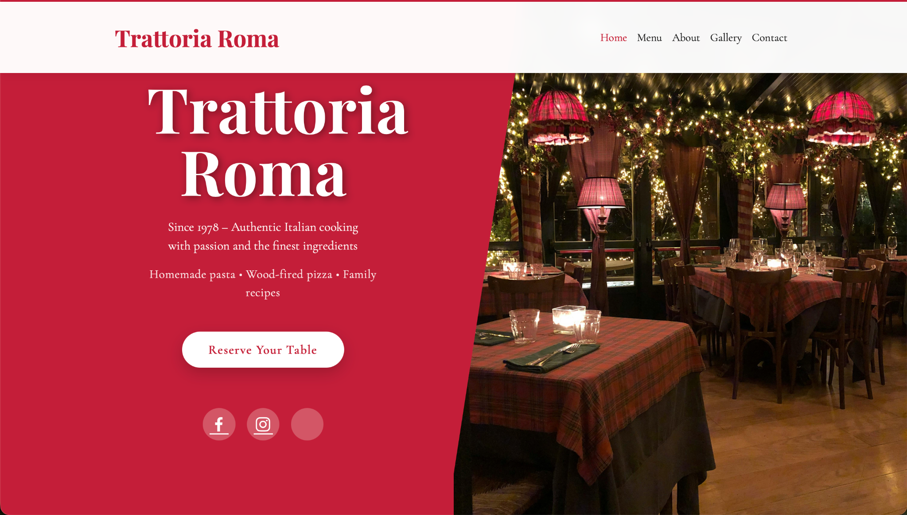
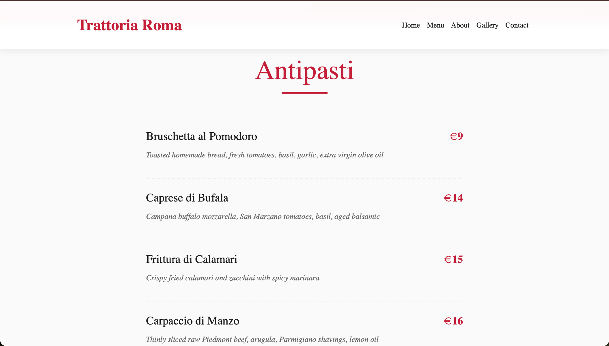
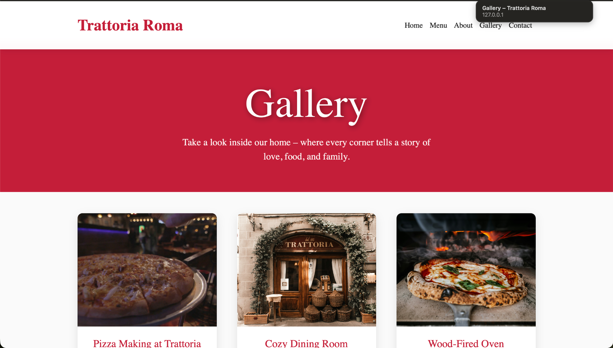
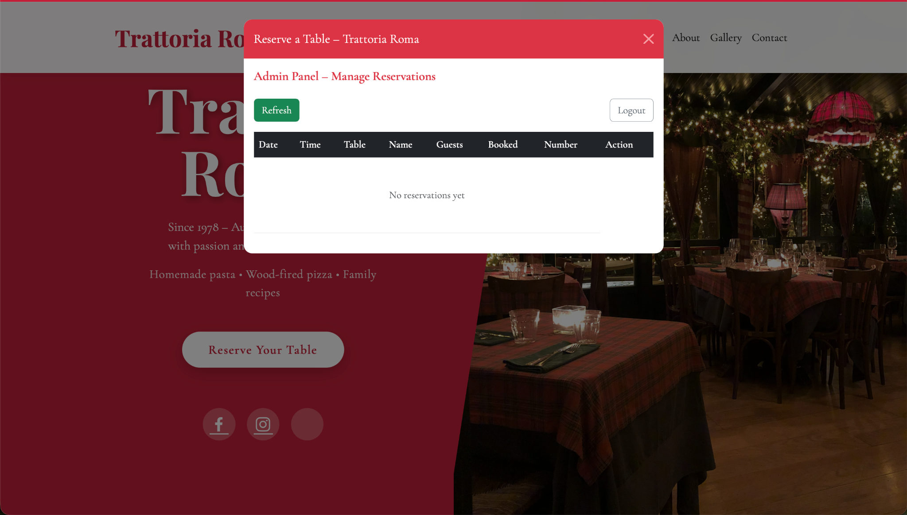
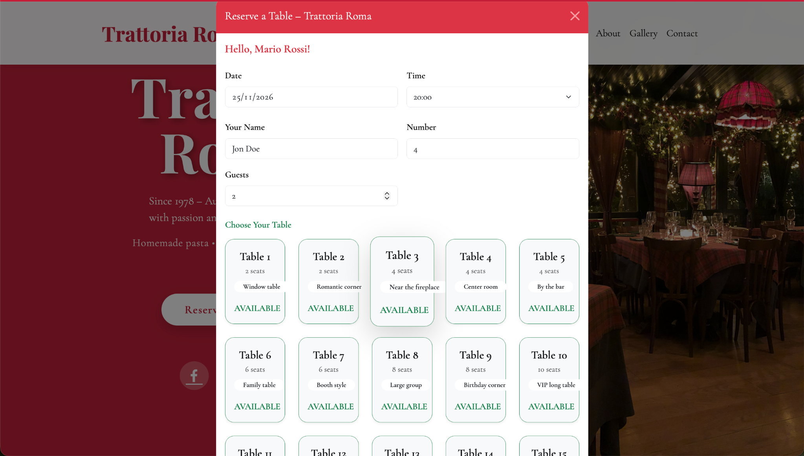
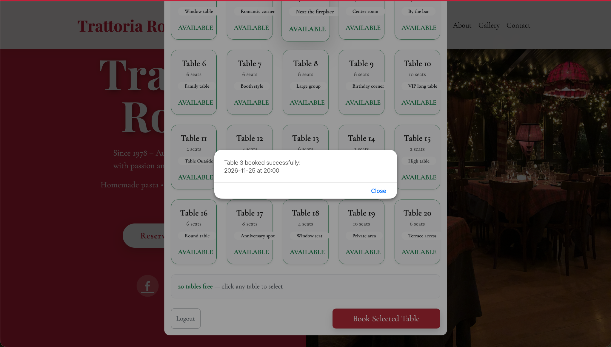
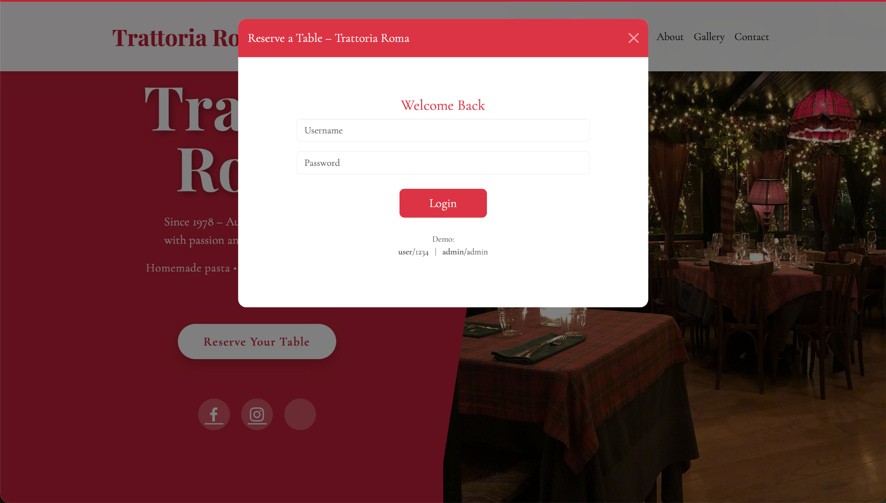
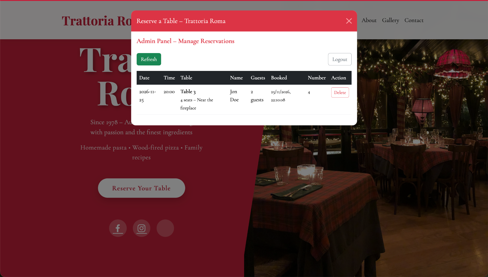
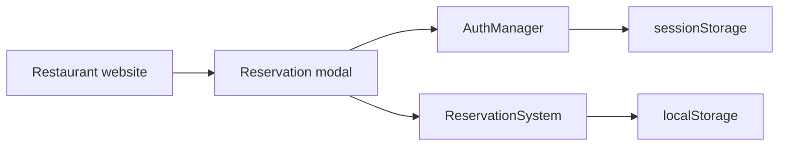

# Trattoria Roma — Restaurant Reservation System

A collaborative frontend project combining a restaurant website with an interactive table reservation prototype.

## Application screenshots

Trattoria Roma is a restaurant website and client-side
reservation system built with HTML, CSS, JavaScript and Bootstrap.

### Landing page



### Restaurant website

| Menu | Gallery |
| --- | --- |
|  |  |

### Reservation workflow





### Booking confirmation



### User access and administration

| Demo login | Admin panel |
| --- | --- |
|  |  |

Reservations are stored locally in the browser.
The login and administration features are educational
demonstrations, not production authentication.

## Features

- Multi-page restaurant website with menu, gallery, about and contact pages.
- Bootstrap reservation modal with visitor and administrator views.
- Twenty tables with different capacities and descriptions.
- Date and time-slot selection, availability display and table selection.
- Guest capacity checks and local reservation storage.
- Administrator reservation overview and deletion.

## Stack

HTML, CSS, vanilla JavaScript, Bootstrap 5.3, Boxicons and Web Storage.

## Architecture



The application runs entirely in the browser. Reservations are indexed by date and time slot; the administrator view lists reservations over the next 15 days.

## Getting started

```sh
git clone https://github.com/mefrinthearea/Restaurant.git
cd Restaurant/Restaurant-reservation
python3 -m http.server 8000
```

Open http://localhost:8000 and select **Reserve Your Table**. Internet access is required for CDN-hosted dependencies.

Use the demonstration accounts displayed in the login modal. Enter fictional customer details only.

## Project structure

```text
Restaurant-reservation/
├── index.html
├── about.html
├── contact.html
├── gallery.html
├── menu.html
├── css/
├── js/
│   ├── auth.js
│   └── reservation.js
├── images/
└── video/
```

## Limitations and security

This is a classroom frontend prototype, not a real reservation service.

- Demo credentials and role checks are client-side and are not secure authentication.
- Browser storage is not a shared database; bookings are not synchronized across devices.
- User-provided values are rendered through HTML templates and require safe rendering before deployment.
- Input validation, including missing telephone numbers, requires improvement.
- Asset usage rights should be verified before public deployment.

## Contributors

- Mefarishvili Giorgi
- Papidze Lexo
- Javakhidze Andria

This is team work; the original contributor attribution is retained.

## Verification

Source inspected for this documentation update. Browser workflows have not been re-tested.
